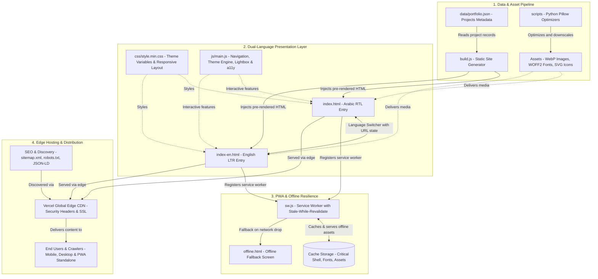

# Portfolio — Eng. Basem Esber

[](https://ammar1993.vercel.app/)


<div align="center">


[](https://developer.mozilla.org/en-US/docs/Web/Guide/HTML/HTML5)
[](https://developer.mozilla.org/en-US/docs/Web/CSS)
[](https://developer.mozilla.org/en-US/docs/Web/JavaScript)
[](https://developer.mozilla.org/en-US/docs/Web/Progressive_web_apps)
[](https://nodejs.org/)
[](https://vercel.com/)

</div>

- [Live Site](https://basemesbr-sys.github.io/)

---

## Overview
A lightweight, user-friendly, and high-performance personal portfolio website showcasing the work of software engineer Ammar Al-Najjar. The site highlights his services, featured projects (web applications, mobile apps, and desktop software), certifications, technical skills, and direct contact channels. It features sub-second loading speeds, full search engine optimization, an adaptive dark and light design, and native bilingual support (Arabic RTL and English LTR).

## Highlights
- 🎨 **Adaptive Theme:** Smooth dark and light modes with system preference auto-detection and cross-tab sync
- 🧭 **Intelligent Navigation:** Sticky navbar with throttled scroll spy and `IntersectionObserver` section tracking
- 🗂️ **Filterable Portfolio:** Category filtering (Web, Mobile, Desktop) with an accessible multi-image Lightbox viewer
- 📱 **Progressive Web App (PWA):** Offline support via Service Worker (Stale-While-Revalidate) and installable app manifest
- 🌐 **Bilingual Architecture:** Native Arabic (`dir="rtl"`) on `index.html` and English (`dir="ltr"`) on `index-en.html`
- 🖼️ **Unified Card Ratios:** Consistent visual layout via CSS custom properties (`--tile-ratio`)
- ♿ **Accessibility (a11y):** Semantic HTML5, ARIA landmarks, keyboard focus traps, and Esc-key modal dismissal
- ⚡ **Ultra Performance:** Self-hosted WOFF2 fonts, WebP imagery, native lazy loading, deferred scripts, and zero framework bloat
- 🔍 **Comprehensive SEO:** Optimized meta tags, Open Graph, Twitter Cards, and dual JSON-LD schemas (`Person` & `CreativeWork`)

## Tech Stack
- **Frontend:** Semantic HTML5, Modern CSS3 (CSS Variables, Flexbox & CSS Grid), Native Inline SVGs
- **JavaScript:** Vanilla ES6+ (Zero heavy external libraries or runtime frameworks)
- **PWA:** Service Worker (`sw.js`), Web App Manifest (`manifest.json`), Offline Fallback (`offline.html`)
- **Build & Optimization:** Node.js (Static HTML injection from JSON), Python (Pillow for image WebP batch processing)
- **Hosting & Infrastructure:** Vercel (Edge network, custom security headers, SSL/TLS)

---

## System Architecture

The following diagram illustrates the end-to-end architecture of the portfolio—from raw project data and image optimization scripts, through the dual-page static generation and PWA caching layers, to global edge deployment on Vercel:



---

## Prerequisites
- Modern web browser (Chrome, Firefox, Safari, Edge)
- [Node.js](https://nodejs.org/) (v16+ recommended, for compiling portfolio data via `build.js`)
- *(Optional)* [Python 3](https://www.python.org/) with `Pillow` (for running image optimization scripts in `scripts/`)

## Quick Start (Local)
1. **Clone the repository:**
   ```bash
   git clone https://github.com/basemesbr-sys.github.io/portfolio.git
   cd portfolio
   ```
2. **Open the project:**
   - Arabic layout: Open `index.html` in your browser.
   - English layout: Open `index-en.html` in your browser.
   - Or run a local HTTP server (recommended for testing Service Worker / PWA features):
     ```bash
     npx serve .
     ```

---

## Build & Development

### 1. Dual-Page Architecture
- [`index.html`](index.html): Primary Arabic entry point (`lang="ar" dir="rtl"`).
- [`index-en.html`](index-en.html): English entry point (`lang="en" dir="ltr"`).

### 2. Updating Portfolio Projects
All project items are centralized in [`data/portfolio.json`](data/portfolio.json). Whenever you modify this file, regenerate the static markup across both pages:
```bash
node build.js
```
This updates the `<div id="portfolio-grid">` section in both `index.html` and `index-en.html` automatically.

### 3. Image Optimization Scripts
- `scripts/convert-to-webp.py`: Bulk converts images to WebP format using Pillow.
  ```bash
  python scripts/convert-to-webp.py [optional_directory_path]
  ```
- `scripts/downscale-portfolio.py`: Resizes large portfolio captures to uniform dimensions to conserve bandwidth.

---

## Deploy on Vercel
1. Push your code to GitHub.
2. Import the repository in [Vercel](https://vercel.com/).
3. Keep default settings (Vercel automatically detects static sites and reads `vercel.json` for security headers).
4. Your site will be live at:
   https://basemesbr-sys.github.io/

---

## Customization

### Brand Color & Fonts
- Change the primary brand color variable in [`css/style.css`](css/style.css):
  ```css
  :root {
    --main-color: #00a78e; /* brand primary color */
  }
  ```
- **Default Fonts:**
  - Arabic: **Cairo** (self-hosted WOFF2 files in `assets/fonts/cairo/`)
  - English: **Poppins** (via Google Fonts)

### Unified Card Ratio (Portfolio Grid)
Adjust card dimensions and aspect ratio via CSS variables in [`css/style.css`](css/style.css):
```css
:root {
  --tile-ratio: 4/3;   /* switch to 16/9 or 1/1 as preferred */
  --tile-min-h: 220px;
}

.portfolio .portfolio-item-inner .portfolio-img {
  aspect-ratio: var(--tile-ratio);
  min-height: var(--tile-min-h);
  display: grid;
  place-items: center;
  background: var(--surface);
}

.portfolio .portfolio-item-inner .portfolio-img img {
  width: 100%;
  height: 100%;
  object-fit: contain;
}
```

### Contact Channels
Update your WhatsApp, email address, or phone number in the **Contact** section of `index.html` and `index-en.html`.

---

## Progressive Web App (PWA)
- **Service Worker (`sw.js`):** Employs a Stale-While-Revalidate caching strategy with versioned cache busting (`v1.4.x`) to serve cached assets instantly while refreshing them in the background.
- **Offline Resilience:** If network connectivity drops, navigation requests gracefully fall back to [`offline.html`](offline.html).
- **Home Screen Install:** Uses [`manifest.json`](manifest.json) configured with maskable icons (192px and 512px) and a custom in-app install button prompt (`.install-btn-trigger`).

---

## SEO & Structured Data
- **Meta Tags:** Informative `<title>`, `<meta name="description">`, canonical links, and `hreflang` alternate tags for Arabic and English versions.
- **Social Cards:** Complete Open Graph and Twitter Card tags configured with `images/og-cover.jpg`.
- **JSON-LD Schemas:**
  - `Person`: Detailed author entity with contact points, university alumni details, and verified profile links.
  - `CreativeWork`: Structured catalog indexing portfolio projects for enhanced search engine results.
- **Bot Control:** Configured [`sitemap.xml`](sitemap.xml) and [`robots.txt`](robots.txt) allowing search engines and modern AI crawlers.

---

## Accessibility
- Semantic HTML5 sectioning (`<header>`, `<main>`, `<section>`, `<footer>`, `<nav>`)
- Descriptive `alt` attributes for all images
- Full keyboard navigation (Tab navigation, Enter/Space to open project lightbox)
- Modal focus trapping and `Esc` key dismissal
- RTL-aware directional navigation (ArrowLeft/ArrowRight adjust according to reading direction)
- Respects `prefers-reduced-motion` and `prefers-color-scheme` media queries

---

## Performance
- Modern WebP image formats throughout the gallery
- Native `loading="lazy"` and `decoding="async"` on non-critical images
- Explicit `width` and `height` dimensions to eliminate Cumulative Layout Shift (CLS)
- Preloaded critical WOFF2 font files and LCP hero image
- Scripts loaded with `defer` to eliminate render-blocking resources
- Throttled scroll and resize handlers using `requestAnimationFrame`

---

## Lighthouse Targets


---

## Screenshots

A selection of key interfaces and audits from this portfolio project. Click any thumbnail to view the full screenshot.

### Home — Hero & Intro
Primary landing section with brief bio, core CTA, and top navigation.


---

### Home (Dark) — Primary Theme
Dark-mode presentation of the hero, showing the default site theme and navigation states.


---

### Home (Dark, English) — English Layout
English-language (LTR) variant demonstrating bilingual support and layout adaptation.


---

### About Section — Profile & Summary
Personal summary, core skills, and a brief timeline / professional snapshot.


---

### Services Section
Overview of offered services with short, actionable descriptions for each service card.


---

### Technologies & Skills Section
Stack badges and proficiency highlights showing core technologies used in projects.


---

### Portfolio Gallery Section — Project Thumbnails
Grid view of selected projects with Lightbox previews and filtering controls.


---

### Certificates Section
Professional certificates and achievements highlighting skill proficiency.


---

### Contact Section
Contact methods, social links, and quick actions for hiring or inquiries.


---

## License

MIT License

Copyright (c) 2026 Basem Esber

Permission is hereby granted, free of charge, to any person obtaining a copy
of this software and associated documentation files (the "Software"), to deal
in the Software without restriction, including without limitation the rights
to use, copy, modify, merge, publish, distribute, sublicense, and/or sell
copies of the Software, and to permit persons to whom the Software is
furnished to do so, subject to the following conditions:

The above copyright notice and this permission notice shall be included in all
copies or substantial portions of the Software.

THE SOFTWARE IS PROVIDED "AS IS", WITHOUT WARRANTY OF ANY KIND, EXPRESS OR
IMPLIED, INCLUDING BUT NOT LIMITED TO THE WARRANTIES OF MERCHANTABILITY,
FITNESS FOR A PARTICULAR PURPOSE AND NONINFRINGEMENT. IN NO EVENT SHALL THE
AUTHORS OR COPYRIGHT HOLDERS BE LIABLE FOR ANY CLAIM, DAMAGES OR OTHER
LIABILITY, WHETHER IN AN ACTION OF CONTRACT, TORT OR OTHERWISE, ARISING FROM,
OUT OF OR IN CONNECTION WITH THE SOFTWARE OR THE USE OR OTHER DEALINGS IN THE
SOFTWARE.

---

## 👤 Author

<div align="center">
  <p>Developed with ❤️ by <b>Eng.Basem Esber (م.باسم اسبر)</b></p>

<p>
  <a href="basem.esbr@gmail.com">
    
  </a>
  <a href="https://wa.me/963988241692">
    
  </a>
  <a href="https://basemesbr-sys.github.io/">
    
  </a>
  </p>
  <div align="center">
   <sub>All rights reserved © 2026 Engineer Basem Esber</sub>
  </div>
</div>
